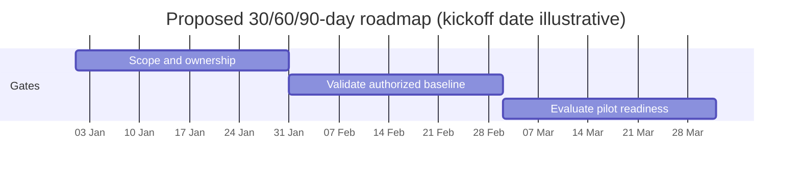

# Proposed operations measurement and implementation plan

The existing [policy interpretation and governance plan](governance.md) applies. The following process, hypotheses and gates are proposed. Public education aggregates do not establish a baseline for recruiting, teaching operations or service workflows.

| Lane | As-is discovery question | Proposed handoff |
|---|---|---|
| Program | Where are intake and capacity decisions recorded? | Submit cohort dates, planned seats and approvals before releasing intake. |
| Instructor Services | Where do stage timestamps and withdrawals get lost? | Assign a requisition owner, stage definitions and a complete contract request. |
| Finance and Academic | How are refunds, staffing and direct costs matched to a cohort? | Reconcile records against a common cohort key and approve staffing and spend. |
| Delivery and Privacy | How are support queues, feedback access and review governed? | Specify first-response and closure events, data access and approval for summaries. |

Root-cause inquiry begins with event completeness, denominator disagreements and handoff ownership. Have each owner review a sample of authorized records, reconstruct the path and compare suspected drivers before ranking causes. Record explicit hypotheses and retain an evidence log. No measured root cause is available in the current sources.

| Work | Responsible | Accountable | Consulted | Informed |
|---|---|---|---|---|
| Scope and definitions | Analyst | Program director | Registrar, Finance, Privacy | Services |
| Recruiting and support events | Services lead | Academic lead | HR, Delivery | Program director |
| Cohort cost reconciliation | Finance analyst | Program director | Registrar, Academic | Services |
| Decision gate and evaluation | Analyst | Program director | Finance, Academic, Privacy | Workstream owners |

## 30/60/90-day roadmap

| Task | Start day | End day | Dependency | Gate |
|---|---:|---:|---|---|
| Scope and ownership | 1 | 30 | Kickoff | Approve definitions and access. |
| Validate authorized baseline | 31 | 60 | Scope and ownership | Reconcile cohorts, transactions and event timestamps. |
| Evaluate pilot readiness | 61 | 90 | Baseline sign-off | Director records proceed, revise or hold. |

Weekly notes list exceptions, decisions, responsible owners and dates. Escalate access issues to Privacy and incomplete intake to the relevant accountable owner. Issue written decisions at the 30/60/90-day gates.

| Risk | Owner | Trigger and mitigation |
|---|---|---|
| Public totals misused as program baselines | Analyst | Any mismatched denominator. Label grain and block the comparison. |
| Missing stage or cohort records | Services lead | Incomplete keys or times. Return the data request and defer scoring. |
| Unauthorized disclosure | Privacy | Personal records included. Hold release and review access, minimization and retention. |
| Uncertain costs and staffing | Finance | Unreconciled estimates or unconfirmed slots. Hold pilot commitment. |

For an approved before/after assessment, report compatible cohorts over mature and comparable follow-up windows. Track volumes and missingness with every KPI, stratify by course or queue, and use a comparison group where feasible. Baseline and follow-up cells remain unfilled. Existing hypothetical calculator uses user-supplied inputs and assigns no realized outcomes.
